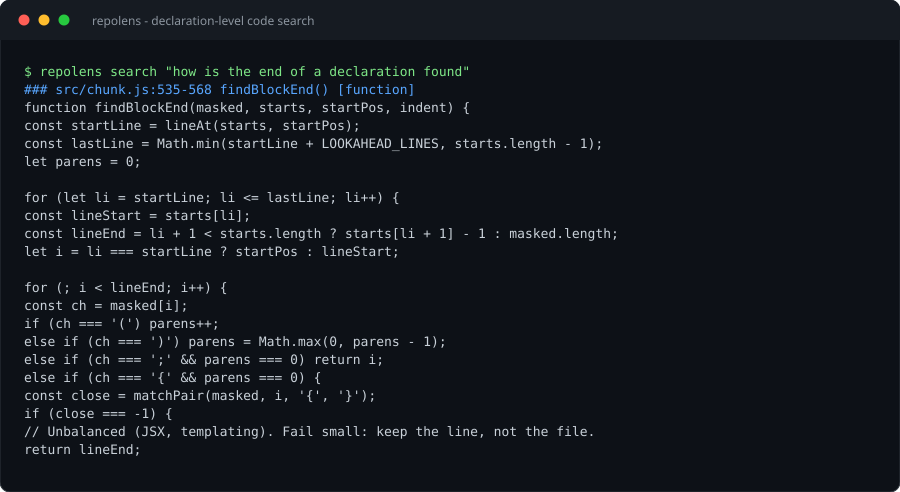

# repolens

**Structure-aware code retrieval for AI coding agents.** An MCP server that indexes a repository into declaration-level chunks and returns the smallest slice that answers a question 鈥?instead of making the agent read whole files.

[](https://github.com/wujiuyi55-sketch/repolens/actions/workflows/ci.yml)




## Why

An agent asked "where is the retry backoff computed?" will `grep`, get 30 hits, and read four whole files 鈥?thousands of tokens to find 40 lines. That is the expensive part of agentic coding: not reasoning, but feeding the context window.

repolens indexes a repo once, then answers at the **declaration** level: `chunk.js:311-334 路 findBlockEnd()`, body included.

## Benchmark

Three third-party repositories, three languages, **questions written from each project's docs and public API 鈥?not from its source**. 12 questions each, 36 total. Gold answers are the chunks that *implement* the behaviour.

| repository | language | queries | top-1 | top-5 | MRR | tokens/answer | grep + read | saving |
| --- | --- | ---: | ---: | ---: | ---: | ---: | ---: | ---: |
| express | JavaScript (CJS) | 12 | 91.7% | **100%** | 0.958 | 835 | 2,952 | 71.7% |
| zod | TypeScript | 12 | 66.7% | 75.0% | 0.694 | 804 | 4,249 | 81.1% |
| httpx | Python | 12 | 66.7% | 91.7% | 0.792 | 1,071 | 41,950 | 97.4% |
| **all** | | **36** | **75.0%** | **88.9%** | **0.815** | **903** | 16,384 | **94.5%** |

The baseline is what an agent does today without an index: grep for the terms, then read every file that matched (capped at 5 files). Tokens are estimated at 3.6 chars/token for source.

Reproduce it:

```bash
git clone --depth 1 https://github.com/expressjs/express ../.corpus/express
git clone --depth 1 https://github.com/colinhacks/zod       ../.corpus/zod
git clone --depth 1 https://github.com/encode/httpx         ../.corpus/httpx
node eval/multirepo.js --reindex          # prints the table above, writes eval/results.json
```

The per-question rows 鈥?including the four misses 鈥?are in [`eval/results.json`](eval/results.json). The harness is checked in; the numbers are not screenshots.

### Chunk coverage

Recall is bounded by what the chunker understands. Coverage = share of non-blank lines that live inside at least one chunk (files 鈮?15 lines):

| repository | code lines | coverage |
| --- | ---: | ---: |
| express | 17,553 | 82.6% |
| zod | 91,701 | 84.5% |
| httpx | 14,376 | 86.9% |

What is *not* covered is mostly unretrievable by construction: re-export files (`index.js` that only re-exports `./lib`), config files, and script-style examples where the logic sits in anonymous callbacks. `node tools/coverage.js <db>` reports the worst files so chunker work is driven by data, not intuition.

## How it works

```
repo 鈹€鈹€鈻?scan 鈹€鈹€鈻?chunk 鈹€鈹€鈻?index (SQLite + FTS5) 鈹€鈹€鈻?rerank 鈹€鈹€鈻?pack 鈹€鈹€鈻?MCP client
          鈹?       鈹?                 鈹?                 鈹?        鈹?       extensions  signature,     BM25 over          symbol identity  token
       + ignore    doc, body      identifier terms   + coverage +     budget
                                                      test/code prior
```

1. **Scan** 鈥?walks the tree, skips `node_modules`/build output, caps file size.
2. **Chunk** 鈥?one declaration per chunk: signature, doc comment, line range, body.
   Handles nested declarations, destructuring parameters, regex literals, CommonJS
   (`exports.x = function`), `describe`/`it` blocks, and Python's indentation rules.
3. **Index** 鈥?SQLite FTS5, external-content table, identifier-split tokens in four
   columns (symbol / path / doc / body) with per-column BM25 weights.
4. **Rerank** 鈥?BM25 only selects candidates; ranking uses symbol identity, how many of
   the question's concepts a chunk contains, parent names, path segments, and a
   definition-over-test prior.
5. **Pack** 鈥?fills a token budget, degrading from full body to signature to omission.

## Quick start

Requires **Node.js 鈮?24** (or 22.5+ with `--experimental-sqlite`). No dependencies, no build step.

```bash
git clone https://github.com/wujiuyi55-sketch/repolens
cd repolens
node src/cli.js index .                 # build .repolens/index.db
node src/cli.js search "token budget"   # query from the terminal
node --test                             # 33 tests
node tools/coverage.js .repolens/index.db
```

Index any repository:

```bash
node src/cli.js index ~/code/express --db /tmp/express.db
node src/cli.js search "middleware stack" --db /tmp/express.db
```

Re-running `index` is incremental: unchanged files (mtime + size) are skipped.

## Use it from an MCP client

```json
{
  "mcpServers": {
    "repolens": {
      "command": "node",
      "args": ["/absolute/path/to/repolens/src/cli.js", "mcp", "--db", "/absolute/path/to/repo/.repolens/index.db"]
    }
  }
}
```

### Tools

| Tool | Question it answers |
| --- | --- |
| `search_code` | where does X live? (natural language or identifier) |
| `get_symbol` | show me X in full |
| `find_references` | who else touches X? |
| `index_stats` | is this repo indexed, and how well? |

`search_code` takes `budgetTokens` (default 1200) so the caller decides how much context to spend.

## Layout

```
src/
  scan.js      walk a repo, decide what is source
  chunk.js     file 鈫?declarations (JS/TS/TSX, Python)
  tokenize.js  identifier-aware tokenizer, shared by index and query
  store.js     SQLite schema, FTS5 external-content index
  indexer.js   build/refresh an index (used by CLI and eval)
  search.js    candidate retrieval + reranking
  pack.js      token-budget packing with graceful degradation
  tools.js     MCP tool definitions
  mcp.js       JSON-RPC over stdio
  cli.js       index | search | mcp | stats
eval/
  queries/*.jsonl   per-repository questions with gold answers
  lib.js            shared metrics (top-k, MRR, token cost)
  multirepo.js      the benchmark above
tools/coverage.js   "which files did the chunker fail to understand?"
```

## Design notes

- **Zero runtime dependencies.** `node:sqlite` (built in since Node 22.5) plus a hand-written
  JSON-RPC stdio transport. Nothing to audit, nothing to break on install.
- **Chunking is heuristic, not AST-based.** A tree-sitter backend would be more precise;
  the chunker is a single module with a stable `Chunk` contract, so swapping it does not
  touch the index or query layer. See [`docs/DESIGN.md`](docs/DESIGN.md).
- **One tokenizer for both sides.** Index and query share `splitWords`, so `getUserById`
  and "user by id" meet in the same vocabulary. This symmetry matters more than any
  scoring tweak.
- **BM25 for recall, rules for precision.** Raw bm25 spans an order of magnitude, so it is
  normalised into a 0鈥?0 band and the explicit signals decide the order.

## Limitations

- JS/TS/JSX/Python only; JSX-heavy files may fall back to signature-only chunks.
- No cross-file symbol resolution: `find_references` is lexical.
- zod's score is lower than the others on purpose 鈥?its v4 code is largely generated
  one-line wrappers and type declarations, which is a known weak spot for a lexical
  chunker and the main argument for tree-sitter.
- Index lives beside the repo; there is no shared daemon or file watcher.
- `node:sqlite` is still marked experimental upstream 鈥?pin your Node version.

## Roadmap

- [ ] tree-sitter chunker behind the same `Chunk` interface
- [ ] call/import graph, so `find_references` can be structural
- [ ] file-watcher mode (`repolens watch`)
- [ ] re-tune BM25F and reranker weights on a corpus 100脳 larger

## License

MIT
